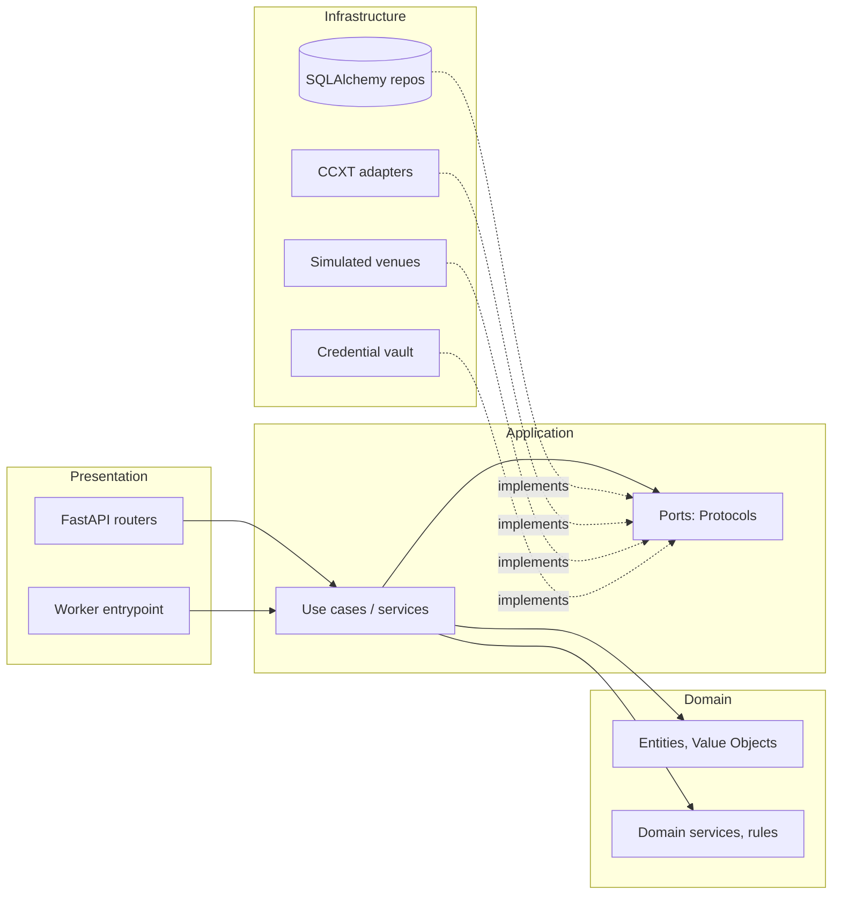

# 02 — Architectural Approach

## Style: modular monolith with a hexagonal core

One repository, one codebase, one database, **two processes** started from the same image:

- `api` — FastAPI HTTP server (stateless).
- `worker` — asyncio process that runs bot trading loops.

Modules are vertical slices (bots, trading, risk, …). Each module owns its tables and exposes a small public interface; other modules never touch its internals or its tables directly. This keeps a later extraction possible without paying microservice costs now.

## Layers

### 1. Domain
Pure Python (stdlib only). Entities, value objects, domain services, domain events, invariants and state machines (e.g. `Order` status transitions, `Bot` state transitions).
- Allowed: `dataclasses`, `decimal`, `enum`, `datetime`, `typing`.
- Forbidden: FastAPI, SQLAlchemy, CCXT, Redis, Pydantic models, `os.environ`, I/O, `datetime.now()` (time arrives through a `Clock` port).

### 2. Application
Use cases (commands/queries), orchestration, transaction boundaries, and the **ports** (Protocols) the domain/app need: repositories, `ExchangePort`, `Clock`, `UnitOfWork`, `CredentialVault`, `EventPublisher`.
- Depends on domain only. Knows nothing about HTTP or SQL.
- One use case = one class/function with an explicit input DTO and output DTO.

### 3. Infrastructure
Adapters implementing ports: SQLAlchemy repositories + unit of work, CCXT exchange adapter, simulated venues, encryption, system clock, Redis (later).
- Maps between ORM rows and domain entities explicitly (no ORM objects leaking upward).
- Retries, rate limiting and error translation (CCXT exceptions → domain/app errors) live here.

### 4. Presentation
FastAPI routers, request/response schemas (Pydantic), auth, error-to-HTTP mapping, dependency wiring via `Depends`. Also the worker's entrypoint and CLI commands.
- No business logic. A route calls one use case.

### Dependency rule
`presentation → application → domain`; `infrastructure → application/domain` (implements ports). The **composition root** (`core/container.py` or per-process `bootstrap`) is the only place that knows concrete classes.

Enforcement: an import-linter configuration (`import-linter` contracts) or a simple pytest that scans imports — *recommended once code exists*, not a new dependency now.

## When a module may be simpler

Not every module deserves four layers. Use a **flat structure** (`models.py`, `service.py`, `repository.py`, `router.py`) when it is mostly CRUD with few rules.

| Module | Structure | Reason |
|---|---|---|
| trading (engine), risk_management, orders/execution, backtesting | Full layers | Rich rules, must be testable without I/O |
| strategies | Domain-heavy (pure code) + small registry | Pure algorithms; no persistence of their own except configs |
| exchanges, market_data | Port + adapters, light domain | Mostly integration; domain is value objects |
| bots, portfolio | Layered but thin | Moderate rules (state machine, allocation) |
| analytics | Application + pure functions | Calculation-heavy, read-only |
| audit, settings | Flat | CRUD / append-only |

Rule of thumb: promote a flat module to layered the first time a business rule needs testing without a database.

## Patterns and where they apply

| Pattern | Use | Avoid when |
|---|---|---|
| Repository | Aggregate persistence (`BotRepository`, `OrderRepository`) | Read-heavy reporting: use query services/SQL views instead |
| Unit of Work | One transaction per use case | — |
| Strategy | Trading strategies; position sizers; fee/slippage models | Trivial one-liners |
| Factory / Registry | `StrategyRegistry` (type key → class), `ExecutionVenueFactory` (mode → adapter) | — |
| Adapter | CCXT → `ExchangePort`; Binance quirks isolated | — |
| State machine | `Bot`, `Order`, `TradingSession` | — |
| Outbox | Reliable events/commands via DB table | Not needed for in-process-only notifications |
| Dependency Injection | Constructor injection, manual composition root | No DI container library |

## Design guidelines

- Prefer `Protocol` (structural typing) over abstract base classes; use inheritance only for true "is-a" with shared behaviour (rare).
- Domain events (`OrderFilled`, `RiskLimitBreached`) are plain dataclasses, dispatched in-process after commit; persisted in `audit_events` and, when needed, an outbox.
- Cross-module calls go through the other module's **public interface** (`modules/<m>/api.py` or exported ports), never its repositories/models.
- Errors: domain exceptions (`RiskLimitExceeded`, `InvalidStateTransition`) → mapped to HTTP problem responses in presentation.
- Time and randomness are injected (`Clock`, `IdGenerator`) so backtests are deterministic.

## Testing strategy by layer

| Layer | Test type | Needs I/O? |
|---|---|---|
| Domain | Unit + property tests (order math, state machines) | No |
| Application | Use-case tests with in-memory fakes of ports | No |
| Infrastructure | Integration tests (Postgres container), CCXT adapter **contract tests** against recorded fixtures; optional testnet smoke tests | Yes |
| Presentation | API tests with `httpx` + app overrides | Minimal |
| Strategies | Golden-data tests: fixed candles → expected signals | No |
