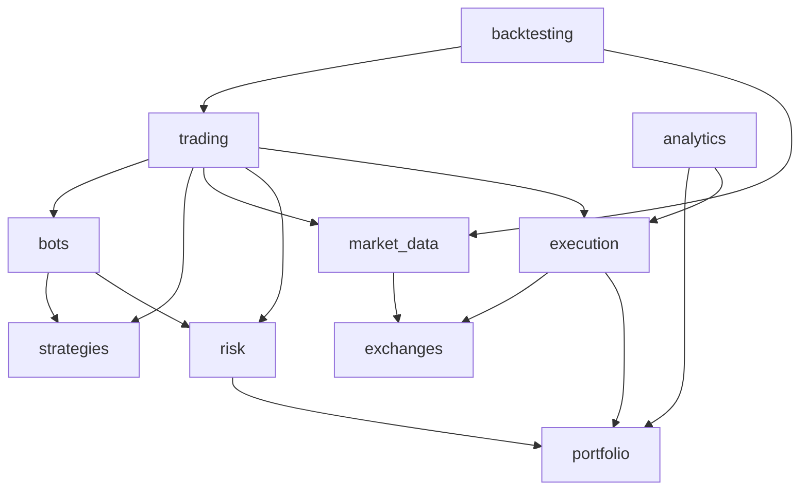

# 03 — Business Modules

## Module map and overlap resolution

Arrows mean "depends on the public interface of". There are no cycles: `risk` reads portfolio *state* through a port; `portfolio` is updated by *events* from execution (it does not call risk).

### Overlaps and how they are resolved

| Ambiguity | Resolution |
|---|---|
| Who decides to trade? | `strategies` emits **signals** only. `risk` approves/sizes/rejects. `trading` orchestrates. `execution` places orders. No module crosses these lines |
| Position sizing: strategy or risk? | Strategy proposes *intent* (side, price, optional size hint). **Risk owns final sizing** using bot limits, capital reservation and exchange minimums |
| Stop-loss | Strategy may *propose* a protective level in the signal; **Risk validates it is present/valid**; **Execution manages the stop order lifecycle**; Trading Engine reacts to triggers |
| Balances: exchange vs. portfolio | `exchanges` fetches raw balances; `portfolio` owns the internal ledger and reconciles against them. Execution only emits fill events |
| Fees and slippage | Fee/slippage **models** belong to the simulated venues (paper/backtest); real fees come from exchange fills. Both are recorded on fills by `execution` |
| Candles in backtest vs live | `market_data` serves both via the same `MarketDataProvider` port (historical or live implementation) |
| Metrics | `analytics` computes everything derived (PnL curves, drawdown). `portfolio` stores facts (balances, positions, snapshots); it does not compute ratios |
| Trading session | Owned by `trading`; referenced (by id) from orders, signals, snapshots |

---

## 3.1 Bot Management (`bots`)

**Purpose.** CRUD and lifecycle of bot configuration; holds *desired* state.
**Entities.** `Bot` (aggregate root), `BotConfig` (value object: strategy ref, params, symbols, timeframe, capital allocation, risk profile ref, execution mode), `BotState` enum (`draft, ready, running, paused, stopping, stopped, error`), `BotStatus` (desired vs. observed).
**Dependencies.** `strategies` (validate parameters), `risk` (validate profile), `exchanges` (connection exists). Not `trading` internals.
**Public interface.** `CreateBot`, `UpdateBotConfig`, `RequestActivation`, `RequestPause`, `RequestStop`, `GetBot`, `ListBots`; port `BotReader` for the engine.
**Rules.**
- Config is immutable while `running`; changes need pause → edit → resume, producing a new `config_version`.
- Execution mode `live` requires the safeguards in doc 05; default mode is `paper`.
- State transitions validated by a state machine; invalid transition → domain error.
- API only changes `desired_state`; the worker changes `observed_state`.
**I/O.** In: config DTOs. Out: Bot DTO with config version and observed vs. desired state.
**Patterns.** Aggregate, State machine, Factory (from validated config), Optimistic locking (`version`).
**MVP.** Create/configure/start/pause/stop, paper mode only. **Later:** clone, templates, scheduled activation, groups of bots.

## 3.2 Trading Strategies (`strategies`)

**Purpose.** Reusable, pure algorithms: `evaluate(context) → list[Signal]`.
**Entities.** `Strategy` (Protocol), `StrategyDefinition` (type key, name, parameter schema, required data/timeframes, warm-up bars), `StrategyParams` (validated), `Signal` (`side`, `symbol`, `kind` entry/exit/adjust, `order_type`, `limit_price?`, `size_hint?`, `stop_loss?`, `take_profit?`, `reason`, `confidence?`), `StrategyContext` (read-only market snapshot, current position/open orders view, strategy-local state, clock).
**Dependencies.** None outward (domain-pure). Uses only value objects from `market_data` (`Candle`, `OrderBookSnapshot`).
**Public interface.** `StrategyRegistry.get(type_key)`, `StrategyRegistry.list()`, `Strategy.evaluate(ctx)`, `Strategy.initial_state()`.
**Rules.**
- A strategy never calls exchanges, repositories, or `datetime.now()`.
- Deterministic: same context → same signals (AI strategies must record model/version/seed and be cached for backtests).
- State is explicit: returned/passed in, persisted by the engine (so it survives restarts); strategy objects hold no hidden mutable state.
- Parameter schemas are Pydantic models (validated in the application layer).
**Initial catalog.** Grid Trading, Mean Reversion, Trend Following (MVP: *one* — grid or simple trend — to prove the pipeline). Triangular Arbitrage: later (multi-leg, latency and fee sensitive, needs atomicity design). AI-assisted: later; implemented as a strategy whose "model" is an injected port (`SignalAdvisor`).
**Patterns.** Strategy, Registry/Factory, Template-free (composition over inheritance).
**MVP vs later.** MVP: protocol, registry, one strategy, golden tests. Later: multi-leg signals, strategy versioning, plug-in loading.

## 3.3 Trading Engine (`trading`)

**Purpose.** Orchestrates one bot's trading cycle; owns trading sessions and the worker runtime.
**Entities.** `TradingSession`, `EngineTick`, `BotRuntime` (in-memory handle: bot, strategy instance, state), `Signal` persistence record.
**Dependencies.** bots, strategies, market_data, risk, execution (all via ports).
**Public interface.** `StartSession`, `StopSession`, `RunTick(bot_id)`, `RecoverSessions()`; supervisor `BotSupervisor` (reconciles desired vs. observed state).
**Cycle (per tick/candle).** load state → fetch snapshot → `strategy.evaluate` → persist signals → `risk.assess` per signal → persist order intents → hand to execution → update portfolio/analytics via events → persist strategy state → heartbeat.
**Rules.**
- One active session per bot (unique partial index).
- A tick is idempotent for the same `(bot_id, bar_close_time)`; re-processing after a crash does not duplicate intents (deterministic intent keys, doc 06).
- Engine never talks to CCXT; it uses `ExecutionPort` and `MarketDataProvider`.
- Fail-safe: unhandled error in a bot → bot goes `error`, open-order policy applied (cancel or leave per config), alert recorded; other bots unaffected.
**Patterns.** Orchestrator/Pipeline, Supervisor, Template of the tick pipeline (steps composed, not inherited).
**MVP.** Single worker, sequential asyncio tasks per bot, candle-close driven. **Later:** tick-level/WebSocket-driven, sharding bots across workers.

## 3.4 Market Data (`market_data`)

**Purpose.** Collect, normalise, store and serve market data uniformly for live and historical use.
**Entities.** `Candle` (OHLCV, symbol, timeframe, open_time UTC, `closed` flag), `Ticker`, `OrderBookSnapshot`, `Trade`, `Symbol`/`Market` metadata (precision, min notional, lot size, tick size), `DataSet` (for backtests).
**Dependencies.** `exchanges` (`MarketDataSource` port).
**Public interface.** `MarketDataProvider`: `get_candles(symbol, tf, start, end)`, `latest_candle(...)`, `subscribe(symbol, tf)` (async iterator of *closed* candles), `get_market_info(symbol)`; `HistoricalDataImporter`.
**Rules.**
- Timestamps are UTC, candle identity = `(exchange, symbol, timeframe, open_time)`; upserts are idempotent.
- Only **closed** candles feed strategies (prevents repainting/look-ahead).
- Gap detection and back-fill; data quality flags.
- Provider returns the same shape for live and historical sources.
**Patterns.** Adapter, Repository (candles), Observer (subscription).
**MVP.** REST polling on candle close for Binance + historical import to Postgres. **Later:** WebSocket streams, order book, multi-exchange normalisation, Parquet/Timescale for large history.

## 3.5 Exchange Integrations (`exchanges`)

**Purpose.** Everything that talks to an exchange. The only module importing CCXT.
**Entities.** `ExchangeConnection` (name, environment `testnet|live`, encrypted credential ref, permissions, status), `ExchangeCapabilities`, `ExchangeOrderResult`, `RateLimitPolicy`.
**Dependencies.** `CredentialVault`, CCXT.
**Public interface (ports).** `ExchangePort`: `fetch_markets`, `fetch_ohlcv`, `fetch_balance`, `create_order(client_order_id, …)`, `cancel_order`, `fetch_order(by client id)`, `fetch_open_orders`, `fetch_my_trades`; `ExchangeFactory.for_connection(conn)`.
**Rules.**
- All order calls carry a **client order id**; lookup by client id is mandatory for reconciliation.
- Rate-limit budget per connection (token bucket honoring Binance weights); respect `Retry-After`/418/429.
- Error taxonomy: `TransientExchangeError` (retryable), `RejectedOrder` (permanent), `AuthError`, `UnknownOutcome` (timeout on a write — *must reconcile, never blindly retry*).
- Testnet and live use separate connections, credentials and base URLs; an adapter instance is bound to exactly one environment.
- Withdrawal permission is never used; API keys should be trade-only with IP whitelist.
**Patterns.** Adapter, Factory, Anti-Corruption Layer, Circuit breaker (later).
**MVP.** Binance spot: public data + testnet orders. **Later:** Binance live, other exchanges, derivatives.

## 3.6 Risk Management (`risk_management`)

**Purpose.** Gatekeeper between signals and orders; also continuous monitor.
**Entities.** `RiskProfile` (per bot), `GlobalRiskPolicy`, `RiskDecision` (`approved | resized | rejected` + reasons), `ExposureSnapshot`, `CapitalReservation`, `KillSwitch`.
**Dependencies.** `portfolio` (read ports for balances/exposure), `market_data` (market info).
**Public interface.** `RiskEngine.assess(signal, bot, portfolio_view) → RiskDecision`; `ReserveCapital`, `ReleaseCapital`; `TripKillSwitch`, `KillSwitchState`; periodic `evaluate_limits()`.
**Rules (configurable).** Max capital per bot; max position size / % of equity; max open orders; max daily loss and max drawdown per bot (auto-pause); global max exposure per asset and total; max order notional; min notional/lot-size/tick-size compliance; mandatory stop-loss policy (per mode); cooldown after losses; price sanity (reject if limit price deviates > X% from last price); fat-finger guard.
**Order of checks:** kill switch → mode safeguards → bot state → data freshness → sizing → exposure → exchange constraints → capital reservation (atomic).
**Patterns.** Chain of Responsibility (rule pipeline, each rule independent and testable), Strategy (position sizers: fixed fraction, fixed notional, volatility-based).
**MVP.** Per-bot limits, global kill switch, sizing, min-notional checks, capital reservation. **Later:** correlation/VaR, dynamic limits, multi-bot portfolio constraints.

## 3.7 Order Execution (`execution`)

**Purpose.** Turn approved order intents into orders on a venue; track state, fills, retries and reconciliation.
**Entities.** `Order` (aggregate, state machine), `OrderIntent`, `Fill`, `Fee`, `ExecutionReport`, `ReconciliationRun`.
**States.** `INTENT → SUBMITTING → OPEN → PARTIALLY_FILLED → FILLED | CANCELED | REJECTED | EXPIRED`, plus `UNKNOWN` (outcome uncertain; resolved only by reconciliation).
**Dependencies.** `ExecutionVenue` port (adapters: backtest, paper, testnet, live), `portfolio` events, `exchanges`.
**Public interface.** `ExecutionPort.submit(intent)`, `cancel(order_id)`, `sync(order_id)`; `Reconciler.run()`; events `OrderSubmitted`, `OrderFilled`, `OrderCanceled`, `OrderRejected`.
**Rules.** Persist intent *before* any network call; transitions only forward; fills are immutable and unique by `(venue, venue_trade_id)`; `filled_qty = Σ fills`; fee recorded per fill with currency; never retry `create_order` after `UnknownOutcome` without reconciliation by client id. See doc 06.
**Patterns.** State machine, Adapter, Strategy (venues), Outbox, Idempotent receiver.
**MVP.** Paper venue + persistence + reconciliation logic; testnet adapter in phase 4. **Later:** live, OCO/stop orders natively on exchange, smart order routing, TWAP.

## 3.8 Portfolio Management (`portfolio`)

**Purpose.** Internal source of truth for what each bot owns.
**Entities.** `Balance` (asset, free, locked, per bot/account), `Position` (symbol, qty, avg entry price, realised/unrealised PnL), `Allocation` (capital assigned to a bot), `PortfolioSnapshot`, `LedgerEntry` (append-only movements).
**Dependencies.** Consumes events from `execution`; reads prices from `market_data`.
**Public interface.** `GetPortfolioView(bot_id)`, `ApplyFill`, `AllocateCapital`, `TakeSnapshot`, `ReconcileWithExchange`.
**Rules.** Balances derive from an append-only ledger (fills, fees, deposits to allocation); `free + locked` invariants; per-bot virtual sub-accounts over a single exchange account; discrepancies with the exchange raise an alert, never silently adjust.
**Patterns.** Ledger/event sourcing-lite, Repository, Read model.
**MVP.** Per-bot virtual ledger, positions, snapshots. **Later:** multi-account, cost-basis methods, tax reports.

## 3.9 Backtesting (`backtesting`)

**Purpose.** Run a strategy + config over historical data using the *same* trading pipeline.
**Entities.** `BacktestRun` (strategy, params, range, data set hash, fee/slippage models, initial capital, seed, status), `BacktestResult` (trades, equity curve, metrics reference).
**Dependencies.** `trading` pipeline with `BacktestVenue` and `HistoricalMarketData`, `analytics`.
**Public interface.** `RunBacktest`, `GetBacktest`, `ListBacktests`, `CompareBacktests`.
**Rules.** Deterministic and reproducible (record data version, params, seed, code version); no look-ahead (only closed candles up to *t*; orders fill from *t+1* by default); fees, slippage and exchange minimums are modeled; results labelled as simulations, never as expected returns; train/test split support.
**Patterns.** Same engine, different adapters (Hexagonal payoff), Clock injection, Template of run loop.
**MVP.** Single-symbol, candle-based, event-loop backtester. **Later:** parameter sweeps (Celery), walk-forward, multi-symbol portfolios, order-book-aware fills.

## 3.10 Analytics (`analytics`)

**Purpose.** Derive performance metrics and reports from stored facts.
**Entities.** `PerformanceMetrics` (total/realised/unrealised PnL, return %, win rate, profit factor, avg win/loss, max drawdown, drawdown duration, Sharpe/Sortino with stated assumptions, exposure time, fees paid, turnover), `EquityCurve`, `MetricWindow`.
**Dependencies.** Reads `portfolio`, `execution` via query ports (read-only).
**Public interface.** `GetBotPerformance(bot_id, window)`, `GetSessionPerformance`, `ComputeBacktestMetrics`, `CompareBots`.
**Rules.** Pure functions over data (NumPy/Pandas); same functions used for backtests and live to guarantee comparable numbers; metrics stored as time-bucketed rows for fast dashboards; always net of fees.
**Patterns.** Query service/CQRS read side, pure functions.
**MVP.** Core metrics + equity curve per bot/session/backtest. **Later:** benchmarks, attribution, scheduled reports.

## Cross-cutting modules (not business modules)

| Module | Role |
|---|---|
| `audit` | Append-only audit events; subscribed to domain events |
| `notifications` | In-app failure alerts: one open alert per episode (`dedupe_key`), cooldown before a flapping condition opens a new one, resolved when the condition stops. The worker evaluates bot, kill switch and candle conditions; the API process evaluates `worker_down` (a dead worker cannot report itself). Critical episodes are also written to `audit_events` |
| `settings`/`core.config` | Typed environment configuration, feature flags (`LIVE_TRADING_ENABLED=false`) |
| `auth` (minimal) | Single-user API authentication (static token/JWT) for MVP |
| `health` | Liveness/readiness, worker heartbeat |
