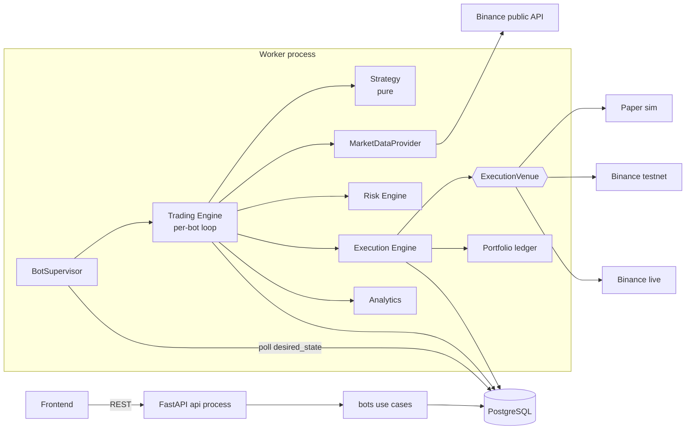
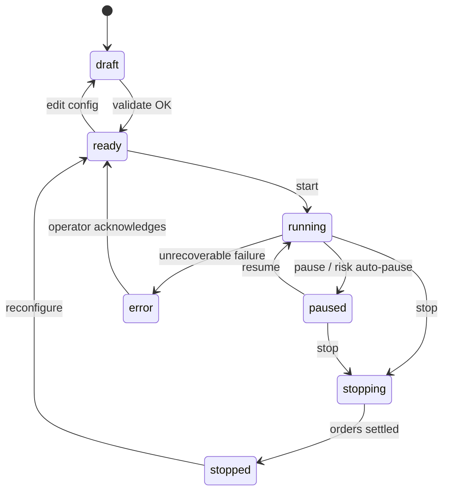
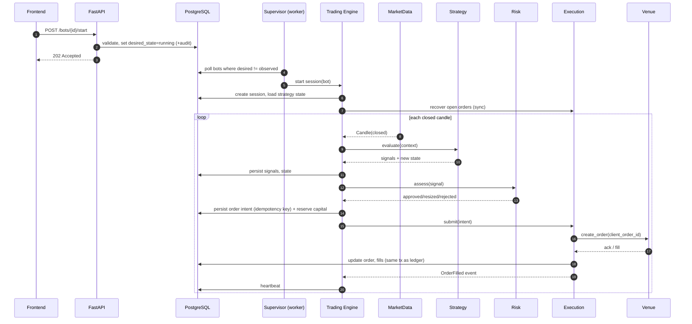

# 04 — Bot Architecture

## Concepts

| Concept | Definition | Persisted? | Knows about |
|---|---|---|---|
| **Bot** | Configured instance: strategy type + params + symbols + capital allocation + risk profile + execution mode + exchange connection | Yes (`bots`, `strategy_configs`) | Strategy *by reference* (type key + params) |
| **Strategy** | Reusable pure algorithm: context → signals | Code only (+ params in config, state snapshot per session) | Market data value objects only |
| **Trading Engine** | Coordinates the lifecycle of a bot's trading cycle (data → strategy → risk → execution → bookkeeping) | Sessions, signals | Ports for everything else |
| **Execution Engine** | Submits, tracks and reconciles orders through an `ExecutionVenue` | Orders, fills | Venue port, portfolio events |

### Decoupling guarantees

- **Strategy ↔ persistence:** the strategy receives an in-memory `StrategyContext` and returns `Signal`s plus an updated opaque `StrategyState`. The *engine* loads/saves state. The strategy has no repository, no bot object, no DB session.
- **One strategy, many bots:** `StrategyRegistry` maps `type_key` → factory. Each bot supplies its own validated params; a new strategy instance (and state) is created per bot/session.
- **Mode transparency:** the strategy cannot tell whether it is in backtest, paper, testnet or live.

```python
# Illustrative contract only (not implementation)
class Strategy(Protocol):
    def initial_state(self) -> StrategyState: ...
    def evaluate(self, ctx: StrategyContext) -> StrategyResult: ...  # signals + new state
```

## Component diagram



## Lifecycle

| # | Phase | What happens | Owner |
|---|---|---|---|
| 1 | Creation | `POST /bots` with name, strategy type, params, symbols, mode (default `paper`) → state `draft` | bots |
| 2 | Configuration | Update params, allocation, risk profile, connection. Each change creates a new immutable `config_version` | bots |
| 3 | Validation | Params vs. strategy schema; symbols exist on the exchange; capital ≤ available; risk profile valid; mode safeguards; warm-up data available. Passing → `ready` | bots + strategies + risk |
| 4 | Activation | `POST /bots/{id}/start` sets `desired_state=running`. Supervisor picks it up, creates `TradingSession`, reserves capital, recovers any open orders/state, sets `observed_state=running` | API → trading |
| 5 | Market data | Engine subscribes to closed candles for the bot's symbols/timeframes; checks data freshness | market_data |
| 6 | Strategy evaluation | Build `StrategyContext` (candles, position, open orders, state, clock) → `evaluate` | strategies |
| 7 | Signal generation | Signals persisted (`trading_signals`) with the context hash and reason | trading |
| 8 | Risk validation | Each signal → `RiskDecision`; rejected signals are recorded with reasons; approved ones are sized and capital reserved atomically | risk |
| 9 | Order execution | Order intent persisted (idempotent key) → submitted to venue → fills tracked → portfolio updated | execution |
| 10 | Performance tracking | Snapshots and metrics updated on fills and periodically | portfolio, analytics |
| 11 | Pause / stop / recovery | Pause: stop evaluating, keep or cancel open orders per policy. Stop: cancel orders, release capital, close session. Recovery after crash: see below | trading |

### Bot state machine



`desired_state` (set by API) and `observed_state` (set by worker) are stored separately; mismatch means the supervisor has work to do.

## Sequence: activation and one tick



## Recovery after restart

1. Supervisor starts, loads bots with `desired_state=running`.
2. For each, find the unfinished session; load last strategy state and last processed bar.
3. Reconcile every order in `SUBMITTING`/`UNKNOWN`/`OPEN` by client order id against the venue (doc 06).
4. Catch up missed candles *for state only* — signals for stale bars are discarded unless the strategy declares them safe (avoids trading on old data).
5. Resume the loop.

## Extension points

- New strategy: implement the protocol, register type key + param schema, add golden-data tests. No change elsewhere.
- New venue: implement `ExecutionVenue`, register in `ExecutionVenueFactory`.
- New risk rule: add a rule class to the chain.
