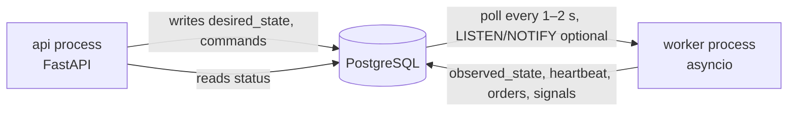

# 07 — Background Processing

## Why trading loops must not live in HTTP endpoints

- Request lifecycles are short and tied to client connections/timeouts; a loop would be cancelled on disconnect, proxy timeout or API restart.
- API replicas/workers (uvicorn/gunicorn) would run duplicates of the same bot, breaking the one-writer guarantee.
- Deploying or scaling the API would interrupt trading; an HTTP crash must not stop (or worse, half-stop) risk management.
- Different resource and failure profiles: the API must stay responsive; trading needs steady long-lived connections.
- Security: the API process should not hold decrypted exchange credentials.

## Option evaluation

| Option | Fit | Verdict |
|---|---|---|
| **AsyncIO** | Natural for I/O-bound loops (REST/WebSocket, DB). `TaskGroup` per bot | **Use** as the runtime inside the worker |
| **Dedicated trading worker** | Separate long-lived process, own lifecycle, holds credentials | **Use** (MVP core) |
| **Celery** | Great for finite jobs (backtest, reports, imports); poor fit for stateful, long-running, exactly-one loops; adds broker | **Defer**; adopt for parallel backtests/imports, not trading loops |
| **Redis** | Pub/sub for UI streaming, shared rate limits, Celery broker | **Defer** until needed |
| **Scheduled jobs** | Periodic reconcile, snapshots, data back-fill | **Use** in-worker (`asyncio` periodic tasks); APScheduler/Celery beat unnecessary for MVP |
| **WebSockets** | Lower latency data/user-data streams | **Later** (`ccxt.pro` or native); MVP polls on candle close |
| **Process supervision** | Restart on crash, health checks | **Use** Docker `restart: unless-stopped` + healthcheck (heartbeat); systemd/K8s later |
| **Graceful shutdown** | Finish tick, persist state, release locks | **Required** (SIGTERM handler) |
| **Recovery after restart** | State persisted in Postgres; reconcile on boot | **Required** (doc 04, 06) |

## Recommended MVP: one asyncio worker, Postgres as command channel

### How FastAPI talks to the engine

1. **Commands** (start/pause/stop/kill-switch) are rows/columns in Postgres: `bots.desired_state` plus an optional `bot_commands` table (id, bot_id, type, payload, status, created_at) for commands that need acknowledgement. API returns `202 Accepted` and the resource's `desired_state`.
2. **Supervisor** in the worker polls for divergence (`desired_state != observed_state`) and reconciles by starting/stopping bot tasks. `LISTEN/NOTIFY` can cut latency later.
3. **Status** flows back through the same tables (`observed_state`, `last_heartbeat_at`, last error). The frontend polls the REST API (SSE/WebSocket push comes later via Redis pub/sub).
4. **Queries** (orders, metrics) are read directly from the DB by the API's query services.

No in-memory sharing, no direct RPC between the two processes: either can restart independently and state is never lost.

Pros: zero extra infrastructure, transactional with business data, naturally durable. Cons: poll latency (seconds — irrelevant for candle-driven strategies); revisit when sub-second control is required.

### Worker internals

- `BotSupervisor` keeps `dict[bot_id, asyncio.Task]`; each bot has its own task and an `asyncio.Lock`-style guard; exceptions are caught at the task boundary → bot `error`, others continue.
- Cooperative cancellation; each tick is the unit of atomicity (do not cancel mid-order-submission — shield the submit step).
- Per-bot DB advisory lock (`pg_try_advisory_lock(hash(bot_id))`) for single-writer guarantee, in addition to the unique active-session index.
- Heartbeat column updated each loop (`last_heartbeat_at`); `/health` reports worker staleness; alert if stale.
- Blocking/CPU work (indicator computation on large frames, backtests) runs in `run_in_executor` or a process pool, never on the event loop.
- Periodic tasks: reconciliation (60 s), portfolio snapshots (e.g. 5 min), metrics, data gap checks, the daily exchange listing snapshot (`market_data/application/listings.py`, run from `JobRunner.run_once`; an empty answer from the exchange is skipped, never read as "everything was delisted").

### Graceful shutdown

On SIGTERM: stop accepting new ticks → finish in-flight tick → shielded completion of pending submits (bounded timeout) → persist strategy state → leave open orders as-is unless policy says cancel → release advisory locks → mark `observed_state=stopped_by_shutdown` (so recovery knows to resume) → exit. Docker `stop_grace_period` set above the maximum tick time.

### Recovery after restart

See doc 04: reload sessions with `desired_state=running`, reconcile uncertain orders first, then resume ticking. Crash (no graceful shutdown) is handled identically — shutdown is an optimisation, not a correctness requirement.

## Scaling path (when justified)

| Need | Step |
|---|---|
| Many bots / heavy CPU | Shard bots across multiple workers by `bot_id` (advisory locks already prevent overlap) |
| Parallel/large backtests | Add Celery + Redis; `RunBacktest` enqueues; same use case executes |
| Live UI updates | Redis pub/sub → SSE/WebSocket endpoint |
| Shared rate limits across workers | Redis-based token bucket |
| Low latency | WebSocket market data and user-data stream; event-driven ticks |

Backtests in the MVP run as an asyncio/executor job inside the worker, triggered by a `backtest_runs` row with `status=queued` (same command-channel pattern).
