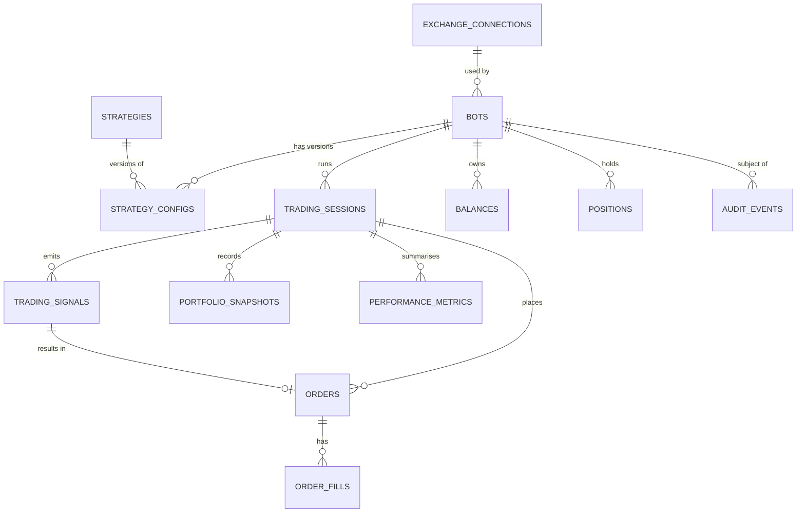
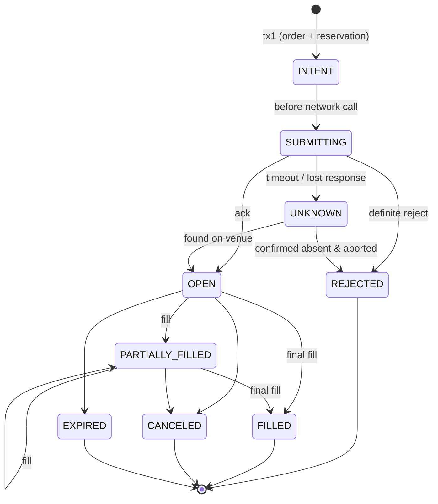

# 08 — Database Architecture (Conceptual)

PostgreSQL is the source of truth. This is a **conceptual** model: no ORM models or migrations exist yet. Names are indicative.

## Cross-cutting rules

| Topic | Rule |
|---|---|
| Money / quantities / prices | `NUMERIC(38, 18)` for quantities and amounts; prices `NUMERIC(38, 18)` as well (altcoin prices need small ticks). Never `FLOAT`/`DOUBLE`. In Python: `Decimal`. Asset-specific precision enforced in the domain via exchange market info, not in column types |
| Timestamps | `TIMESTAMPTZ`, always UTC. Store `created_at`, `updated_at`; exchange event time (`exchange_ts`) separately from local `received_at` |
| IDs | `UUID` (v7 preferred for index locality) generated by the app (`IdGenerator`), so intents have ids before insert. Candles use a composite natural key |
| Enums | `TEXT` + `CHECK` constraint (easier to migrate than PG enums) |
| Soft vs hard delete | Financial records (orders, fills, ledger, audit) are **never deleted or updated in place** (except order status/qty progression). Bots are archived (`archived_at`), not deleted, once they have sessions |
| Transactions | One use case = one transaction (Unit of Work). Rule: *order intent + capital reservation + signal consumption* commit atomically; *fill + order update + ledger entries + position update* commit atomically. **Network calls never happen inside a DB transaction** |
| Concurrency | Optimistic `version` on aggregates (`bots`, `orders`); `SELECT … FOR UPDATE` on balance rows for reservations; advisory locks for bot ownership |
| Consistency | `CHECK` constraints: `filled_qty <= quantity`, `free >= 0`, `locked >= 0`; status ↔ field consistency (e.g. `FILLED` ⇒ `filled_qty = quantity`) enforced in domain and constraints where feasible |
| Sensitive data | Only `exchange_connections.credentials_encrypted`; app DB role cannot `UPDATE/DELETE` on `audit_events`; backups (`python -m manage backup`, see `docs/operations/runbook.md`) hold those credentials encrypted with the master key, which is kept apart from the dumps |
| Historical data | Config versions, signals, snapshots and metrics are retained so any decision can be explained and any backtest reproduced |
| Migrations | Alembic, linear history, reviewed; destructive migrations need a backup step |

## Entity overview

## Entities

### strategies
- **Responsibility:** catalogue of available strategy types (mirror of the code registry; useful for FKs and UI).
- **Fields:** `id`, `type_key` (unique, e.g. `grid`), `name`, `description`, `param_schema` (JSONB), `implementation_version`, `active`.
- **Constraints:** unique `type_key`. **Index:** `type_key`.

### strategy_configs
- **Responsibility:** immutable, versioned parameter set for a bot's strategy.
- **Fields:** `id`, `bot_id`, `strategy_id`, `version` (int), `params` (JSONB, validated against schema), `params_hash`, `created_at`, `created_by`.
- **Relations:** many per bot; referenced by sessions and backtests.
- **Constraints:** unique `(bot_id, version)`; rows never updated. **Index:** `(bot_id, version DESC)`. JSONB used because params differ per strategy; GIN index only if queried.

### exchange_connections
- **Responsibility:** account/connection to an exchange environment.
- **Fields:** `id`, `exchange` (`binance`), `environment` (`testnet|live`), `label`, `credentials_encrypted` (BYTEA), `key_id`, `api_key_hint` (last 4), `permissions_verified_at`, `status`, `created_at`.
- **Constraints:** unique `(exchange, environment, label)`; CHECK environment values. **Sensitive.**

### bots
- **Responsibility:** bot aggregate root.
- **Fields:** `id`, `name`, `strategy_id`, `current_config_id`, `exchange_connection_id`, `execution_mode` (`paper|testnet|live`; backtests are separate), `symbols` (TEXT[]), `timeframe`, `allocated_capital`, `quote_asset`, `risk_profile` (JSONB or FK), `desired_state`, `observed_state`, `last_heartbeat_at`, `last_error`, `live_approved_config_version`, `version`, `archived_at`, timestamps.
- **Constraints:** unique `name` (where not archived); `execution_mode='live'` ⇒ `live_approved_config_version = current config version` (checked in domain). **Indexes:** `(desired_state, observed_state)` for the supervisor; `(archived_at)`.

### trading_sessions
- **Responsibility:** one continuous run of a bot in one mode; scope for orders/metrics.
- **Fields:** `id`, `bot_id`, `config_id`, `mode`, `status`, `started_at`, `ended_at`, `end_reason`, `initial_capital`, `last_processed_bar_time`, `strategy_state` (JSONB), `worker_id`.
- **Constraints:** **partial unique index `(bot_id) WHERE status='active'`** (single active session). **Indexes:** `(bot_id, started_at DESC)`.

### trading_signals
- **Responsibility:** record of every strategy intent and its risk outcome (explainability).
- **Fields:** `id`, `session_id`, `bot_id`, `symbol`, `side`, `kind`, `order_type`, `limit_price`, `size_hint`, `stop_loss`, `take_profit`, `reason`, `bar_time`, `context_hash`, `risk_decision` (`approved|resized|rejected`), `risk_reasons` (JSONB), `created_at`.
- **Constraints:** unique `(session_id, symbol, bar_time, signal_index)` → idempotent ticks. **Indexes:** `(session_id, created_at)`, `(bot_id, bar_time)`.
- **Volume:** high; consider time partitioning later.

### orders
- **Responsibility:** lifecycle of an order (aggregate with fills).
- **Fields:** `id`, `session_id`, `bot_id`, `signal_id`, `exchange_connection_id`, `client_order_id`, `exchange_order_id` (nullable until acked), `symbol`, `side`, `type`, `time_in_force`, `quantity`, `price`, `stop_price`, `filled_qty`, `avg_fill_price`, `status`, `reject_reason`, `reserved_amount`, `reserved_asset`, `submitted_at`, `closed_at`, `version`, timestamps.
- **Constraints:** **unique `(exchange_connection_id, client_order_id)`**; unique `(session_id, signal_id, leg)`; CHECK `0 <= filled_qty <= quantity`; CHECK status values; status transitions enforced by the domain state machine (forward only). Paper orders use a synthetic connection/venue id to keep uniqueness semantics.
- **Indexes:** `(bot_id, status)` partial on open statuses; `(session_id, created_at)`; `exchange_order_id`; `(status) WHERE status IN ('SUBMITTING','UNKNOWN')` for recovery.

### order_fills (executions)
- **Responsibility:** immutable trade executions against an order.
- **Fields:** `id`, `order_id`, `venue_trade_id`, `quantity`, `price`, `quote_qty`, `fee_amount`, `fee_asset`, `is_maker`, `slippage_bps` (nullable), `exchange_ts`, `received_at`.
- **Constraints:** unique `(order_id, venue_trade_id)`; insert-only; sum of fills = `orders.filled_qty` (verified by reconciliation and a deferred check/trigger or application invariant). **Indexes:** `(order_id)`, `(exchange_ts)`.

### positions
- **Responsibility:** current net holding per bot/symbol, with cost basis.
- **Fields:** `id`, `bot_id`, `symbol`, `quantity`, `avg_entry_price`, `realized_pnl`, `fees_paid`, `opened_at`, `updated_at`, `version`.
- **Constraints:** unique `(bot_id, symbol)`. Derivable from fills (rebuildable for verification). Spot-only in MVP (no negative quantity).

### balances
- **Responsibility:** per-bot virtual balance of each asset (free vs. locked).
- **Fields:** `id`, `bot_id` (or account scope), `asset`, `free`, `locked`, `updated_at`, `version`.
- **Constraints:** unique `(bot_id, asset)`; `free >= 0`, `locked >= 0`; updated only inside transactions that also write a `ledger_entries` row (append-only movements: `ref_type`, `ref_id`, `delta_free`, `delta_locked`) so balances can be audited/rebuilt. Reconciled against exchange totals.

### portfolio_snapshots
- **Responsibility:** point-in-time valuation for equity curves.
- **Fields:** `id`, `session_id`, `bot_id`, `taken_at`, `quote_asset`, `total_equity`, `cash`, `positions_value`, `realized_pnl`, `unrealized_pnl`, `holdings` (JSONB).
- **Constraints:** unique `(session_id, taken_at)`. **Indexes:** `(bot_id, taken_at)`. Append-only.

### performance_metrics
- **Responsibility:** computed metrics per scope and window (cached analytics).
- **Fields:** `id`, `scope_type` (`session|bot|backtest`), `scope_id`, `window_start`, `window_end`, `metrics` (JSONB: pnl, return, win_rate, profit_factor, max_drawdown, sharpe, fees, trades…), `computed_at`, `calc_version`.
- **Constraints:** unique `(scope_type, scope_id, window_start, window_end, calc_version)`. Recomputable; may be dropped and rebuilt.

### audit_events
- **Responsibility:** append-only trail of significant actions.
- **Fields:** `id`, `occurred_at`, `actor` (user/system/worker), `event_type`, `entity_type`, `entity_id`, `bot_id?`, `correlation_id`, `payload` (JSONB, secrets redacted), `ip?`.
- **Constraints:** no UPDATE/DELETE privileges for the app role (trigger as backup). **Indexes:** `(entity_type, entity_id, occurred_at)`, `(event_type, occurred_at)`, `(correlation_id)`. Candidate for time partitioning.

### Supporting tables (outside the required list)

| Table | Purpose |
|---|---|
| `candles` | `(exchange, symbol, timeframe, open_time)` PK, OHLCV `NUMERIC`, `ingested_at`. Largest table; upsert-idempotent; partition by time or move to Timescale/Parquet if volume demands |
| `markets` | Cached exchange market metadata (precision, minimums) with `fetched_at` |
| `backtest_runs` / `backtest_trades` | Run definition, data hash, seed, status, results; trades stored separately from live `orders` so simulations never pollute real records |
| `bot_commands` | Optional command/ack channel for the worker (doc 07) |
| `ledger_entries` | Append-only balance movements |
| `risk_events` | Limit breaches, kill-switch trips (could be `audit_events` subtype) |

## Order lifecycle consistency

Every transition is compare-and-set on `version` + current status, so concurrent workers/reconcilers cannot move an order backwards or twice.

## Indexing and performance notes

- Index for the hot paths only: supervisor poll, open orders per bot, recovery of in-flight orders, candle range scans, equity curve by `(bot_id, taken_at)`.
- Keep JSONB for flexible, rarely-filtered payloads (params, holdings, risk reasons); promote to columns when queried.
- Retention: signals/snapshots can be down-sampled after N months; orders, fills, ledger and audit are retained.
- Read-heavy analytics may use materialised views refreshed by the worker; do not add a read replica or Timescale until measured need.
