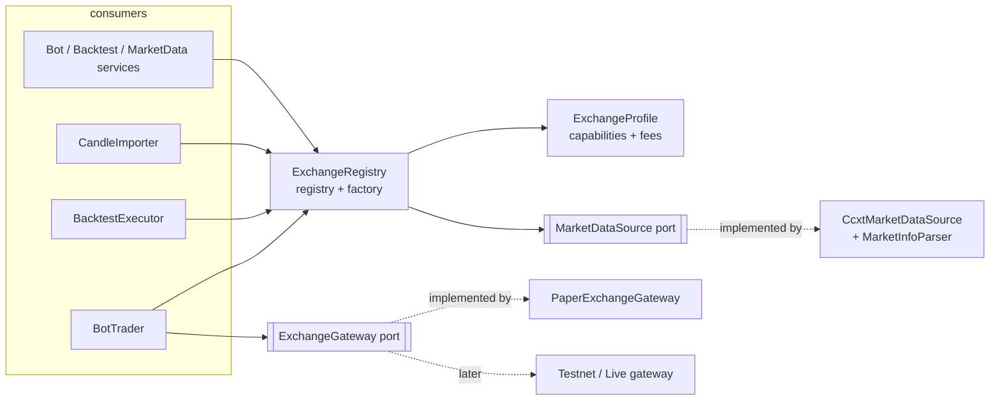

# 10 — Exchange abstraction and how to add an exchange

Nothing outside `modules/exchanges/` knows which exchange it talks to. Strategies, risk, the
trading loop, the backtester and the API depend on **ports and value objects**, never on CCXT
or Binance.

## Pieces

| Piece | Where | Role |
|---|---|---|
| `ExchangeProfile` = `ExchangeCapabilities` + `FeeSchedule` | `exchanges/domain/models.py` | Static facts: order types, native stops, client-id length, testnet, timeframes, maker/taker fees. Callers branch on **capabilities**, never on the exchange name |
| `ExchangeRegistry` | `exchanges/application/registry.py` | Registry + factory: `profile(id)`, `require(id, timeframe)`, `market_data(id)` (lazy, shared), `aclose()` |
| `MarketDataSource` port | `market_data/application/ports.py` | Candles and market rules |
| `ExchangeGateway` port | `exchanges/application/ports.py` | `create_market_order` (idempotent on `client_order_id`), `fetch_order`, `cancel_order` |
| `PaperExchangeGateway` | `execution/venues/paper.py` | Reference implementation of the gateway contract (simulated fills at real prices) |
| `CcxtMarketDataSource` | `exchanges/infrastructure/ccxt_adapter.py` | Generic CCXT adapter; the only place importing `ccxt`. Takes an exchange-specific `MarketInfoParser` |
| Binance profile + parser | `exchanges/infrastructure/binance.py` | Everything Binance-specific: filters (`LOT_SIZE`, `PRICE_FILTER`, `NOTIONAL`), 36-char client ids, testnet flag, fees |
| Catalog | `exchanges/infrastructure/catalog.py` | `build_exchange_registry()`: the list of supported exchanges |

Patterns: **Registry/Factory** (which exchange), **Adapter** (CCXT → ports), **Strategy**
(`MarketInfoParser` per exchange), **Ports and Adapters** (gateway), **Anti-corruption layer**
(CCXT errors become `ExchangeError` subclasses; nothing else leaks).

Bots and backtests store an `exchange` id (default `binance`); candles are keyed by
`(exchange, symbol, timeframe, open_time)`; fees default to the exchange's taker rate when not
given.

## Adding an exchange (e.g. Kraken)

1. **Profile**: create `exchanges/infrastructure/kraken.py` with an `ExchangeProfile` (capabilities
   and fee schedule) and, if CCXT's generic precision/limits are not exact enough, a
   `MarketInfoParser` (see `binance_market_info`).
2. **Factory**: `def create_kraken_market_data() -> CcxtMarketDataSource` using
   `CcxtMarketDataSource("kraken", market_parser=...)`.
3. **Register**: one line in `catalog.py`: `registry.register(KRAKEN_PROFILE, create_kraken_market_data)`.
4. **Tests**: add the new gateway factory (when it has one) to `GATEWAY_FACTORIES` in
   `tests/unit/test_exchange_abstraction.py`; the contract suite then validates it. Add the
   exchange to the parser/profile unit tests.

No change is needed in strategies, risk, trading, backtesting, bots or the API.

## Stops: engine-side now, native later

`ExchangeCapabilities.native_stop_orders` states whether an exchange keeps stop orders itself.
Today stop-loss / take-profit are **monitored by the bot** against each closed candle's
low/high (paper and backtest behave identically). That does not protect while the worker is
down, which is why stale-candle catch-up still executes stops and why the heartbeat/status
endpoints exist. When the Binance testnet/live gateway arrives, bots on exchanges that support
native stops should place them there; the decision point is the capability flag.

## What is deliberately not there yet

* No private account port (balances, trade history) and no real-order gateway: they need
  credentials, the credential vault and reconciliation (Phase 4).
* Rate limiting relies on CCXT's `enableRateLimit`; a shared, weight-aware limiter is a Phase 4
  concern once several processes use the same API key.
