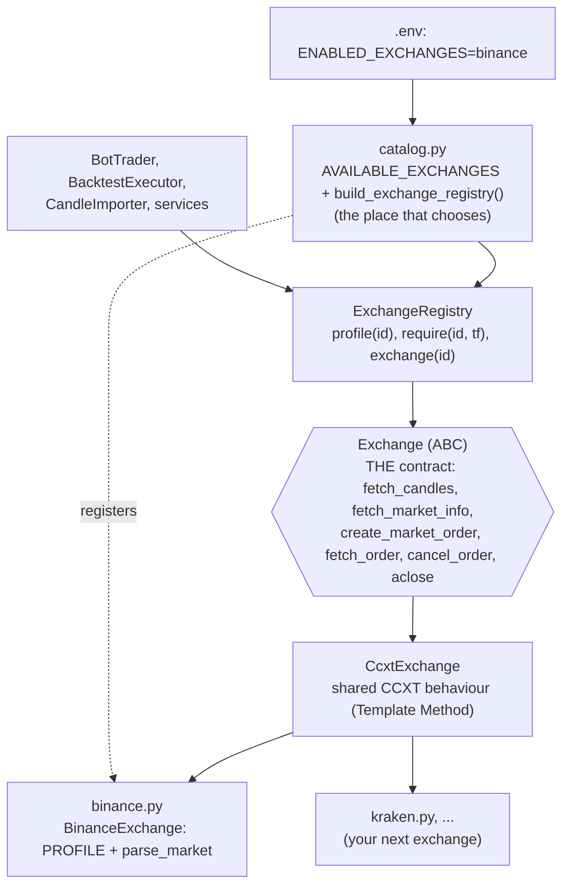

# 10 — Exchange abstraction and how to add an exchange

The rule: **one contract, one file per exchange, one place that chooses.** Nothing outside
`modules/exchanges/` knows which exchange it talks to; strategies, risk, the trading loop, the
backtester and the API depend on the contract and on plain value objects, never on CCXT or an
exchange name.

## Design patterns used

| Pattern | Where | Why |
|---|---|---|
| **Adapter** | `binance.py`, one per exchange | Adapts each exchange's API to the single `Exchange` contract and returns the value objects the system expects (`Candle`, `MarketInfo`, `VenueOrder`) |
| **Ports and Adapters** (hexagonal) | `Exchange` ABC vs. consumers | The core depends on the contract; integrations plug in from outside |
| **Template Method** | `CcxtExchange` | Candle conversion, retries and error translation are written once; each exchange overrides only hooks like `parse_market` |
| **Registry + Factory** | `ExchangeRegistry` | Holds the enabled exchanges, exposes their static profile without building a network client, creates the integration lazily |
| **Strategy** (selection) | `catalog.py` + `ENABLED_EXCHANGES` | Which integration(s) a deployment uses is configuration, not code |
| **Interface Segregation** | `MarketDataSource`, `ExchangeGateway` | Consumers receive the narrow view they need; `Exchange` satisfies both |
| **Anti-corruption layer** | `ccxt_exchange.py` | CCXT exceptions become `ExchangeError` subclasses; no SDK type leaks |

## Files

| File | Role |
|---|---|
| `exchanges/application/exchange.py` | **The contract**: the `Exchange` ABC with every function an exchange must provide and what each must return/raise |
| `exchanges/domain/models.py` | `ExchangeProfile` = `ExchangeCapabilities` + `FeeSchedule` (static facts; callers branch on capabilities, never on the exchange name) |
| `exchanges/application/ports.py` | Order value objects and the narrow `ExchangeGateway` view |
| `exchanges/application/registry.py` | `ExchangeRegistry` |
| `exchanges/infrastructure/ccxt_exchange.py` | Shared base for CCXT exchanges (the only module importing `ccxt`) |
| `exchanges/infrastructure/binance.py` | **Everything specific to Binance**, in one file |
| `exchanges/infrastructure/catalog.py` | **The choice**: `AVAILABLE_EXCHANGES` (what exists) and `build_exchange_registry(enabled)` |
| `execution/venues/paper.py` | `PaperExchangeGateway`: simulated fills behind the same gateway port |

## Choosing the exchange

* `ENABLED_EXCHANGES` (environment, comma separated, default `binance`) decides which integrations
  a deployment activates. A name with no integration, or an empty list, fails at startup.
* Each bot, backtest and import carries an `exchange` id; requests naming a disabled exchange get
  a clear 422.
* Fees default to the exchange's profile when a bot/backtest does not set `fee_rate`.

## Adding an exchange (e.g. Kraken)

1. Copy `binance.py` to `kraken.py`. Change `PROFILE` (id, order types, native stops?, client-id
   length, testnet?, timeframes, fees) and override `parse_market` only if CCXT's generic
   `precision`/`limits` are not exact enough. If the exchange is not CCXT-based, subclass
   `Exchange` directly and implement the six methods.
2. Add one line to `AVAILABLE_EXCHANGES` in `catalog.py`.
3. Set `ENABLED_EXCHANGES=binance,kraken` where you want it active.
4. Add the class to `EXCHANGE_FACTORIES` in `tests/unit/test_exchange_abstraction.py`: the
   contract tests then verify it returns the expected value objects, raises the expected errors
   and exposes a complete profile.

If a method is missing Python refuses to instantiate the class; if `PROFILE` is missing the
registry refuses to register it. No change is needed in strategies, risk, trading, backtesting,
bots or the API.

## Real orders: gated, not missing

The contract already includes order placement, cancellation and lookup. In `CcxtExchange` those
raise `TradingNotEnabled` until real orders are built behind credentials, the credential vault
and reconciliation (Phase 4); the paper venue implements the same operations through
`ExchangeGateway`, so the trader already speaks the final interface.

## Stops: engine-side now, native later

`ExchangeCapabilities.native_stop_orders` states whether an exchange keeps stop orders itself.
Today stop-loss / take-profit are **monitored by the bot** against each closed candle's
low/high (paper and backtest behave identically). That does not protect while the worker is down,
which is why catch-up still executes stops and why `/system/status` exists. When the Binance
testnet/live path arrives, exchanges with native stops should hold them on the exchange; the
decision point is that capability flag.
