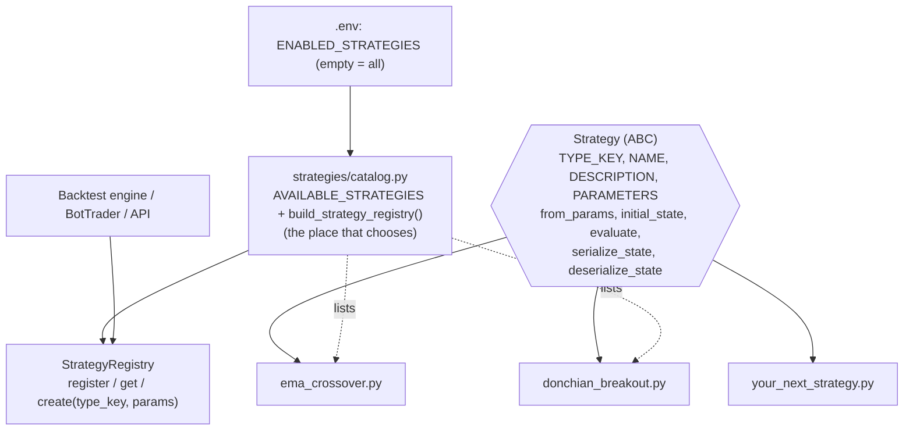

# 11 — Strategies: one contract, one file per strategy

Same rule as exchanges: **one contract, one file per strategy, one place that chooses.** The
backtester, the bots, the risk layer and the API depend only on the `Strategy` contract. A
strategy knows nothing about databases, exchanges, bots or HTTP.

## Design patterns used

| Pattern | Where | Why |
|---|---|---|
| **Strategy** (GoF) | `Strategy` ABC and each strategy file | Interchangeable algorithms behind one interface; the engine never knows which one runs |
| **Registry + Factory** | `StrategyRegistry` | `create(type_key, params)` builds a fresh, validated instance for every bot/backtest, so many bots can share one strategy with different parameters |
| **Plugin / self-describing component** | `TYPE_KEY`, `NAME`, `DESCRIPTION`, `PARAMETERS` on the class | The strategy file is the single source of truth for its metadata; `GET /strategies` is generated from it |
| **Memento-style explicit state** | `serialize_state` / `deserialize_state` | State is a value returned from `evaluate` and persisted by the engine, so a restarted bot resumes exactly where it was and the strategy never touches persistence |

## The contract (`strategies/domain/base.py`)

| Member | Meaning |
|---|---|
| `TYPE_KEY` | Stable snake_case id stored in bots and backtests |
| `NAME`, `DESCRIPTION`, `PARAMETERS` | Human-facing metadata; `PARAMETERS` is a tuple of `ParamSpec` (name, type, default, description, minimum) |
| `from_params(params)` | Build from raw JSON params with defaults; raise `InvalidStrategyParams` for unknown keys, wrong types or invalid values |
| `initial_state()` | State before any candle |
| `evaluate(ctx, state)` | One **closed** candle in, `StrategyResult(signals, new_state)` out. Pure and deterministic; never mutates `state`; no signals while warming up |
| `serialize_state` / `deserialize_state` | JSON round trip of the state (Decimals as strings) |

Signals are *intent* (`BUY`/`SELL`, a reason, optional `stop_loss` / `take_profit` price levels).
Sizing, risk, execution and the stop monitoring belong to other modules, which is what lets the
same file run in backtest and in paper trading unchanged. Helpers shared by strategies live next
to the contract: `parse_numeric_params`, `percent_below_above`, `validate_percent`.

## Files

| File | Role |
|---|---|
| `strategies/domain/base.py` | **The contract** and helpers |
| `strategies/domain/types.py` | Data the contract exchanges: `Signal`, `StrategyContext`, `StrategyResult`, `Side` |
| `strategies/domain/ema_crossover.py` | Strategy: EMA fast/slow crossover |
| `strategies/domain/donchian_breakout.py` | Strategy: Donchian channel breakout |
| `strategies/domain/registry.py` | `StrategyRegistry` (validates metadata, refuses duplicates) |
| `strategies/catalog.py` | **The choice**: `AVAILABLE_STRATEGIES` and `build_strategy_registry(enabled)` |

## Adding a strategy

1. Create `strategies/domain/my_strategy.py` with a class `MyStrategy(Strategy[MyState])`:
   set `TYPE_KEY`, `NAME`, `DESCRIPTION`, `PARAMETERS`; implement `from_params`, `initial_state`,
   `evaluate`, `serialize_state`, `deserialize_state`. Copy `donchian_breakout.py` as a template.
2. Add the class to `AVAILABLE_STRATEGIES` in `strategies/catalog.py`.
3. Run `make test`. `tests/unit/test_strategy_contract.py` automatically runs the whole contract
   against it: metadata, param validation, JSON state round trip, determinism, no state mutation,
   a restarted bot continuing identically, well-formed alternating signals and protective levels.
   Add a few tests for what is specific to your algorithm.
4. It is immediately available as `strategy_type` in `POST /bots`, `/backtests` and
   `/backtests/sweeps`, and listed (with its parameters) in `GET /strategies`.

Python refuses to instantiate a strategy with a missing method, and the registry refuses one with
missing metadata or a duplicate key, so a half-written strategy fails at startup, not at runtime.

To keep a work-in-progress strategy off a production worker, set `ENABLED_STRATEGIES`
(comma separated `TYPE_KEY`s); empty enables all.

## Rules of the road

* Use only the candle in `ctx` and your own `state`: no clock, no network, no randomness (an AI
  advisor would be injected as a pure dependency of the instance and cached for backtests).
* Look-ahead is impossible by construction (one closed candle at a time), but don't build
  indicators from the *current* candle where the rule says "previous" (see Donchian's channel).
* Keep `evaluate` quiet while warming up; the trader also feeds warm-up candles without trading.
* Leave sizing and exits-by-risk to the risk module; propose stop/target levels instead.
