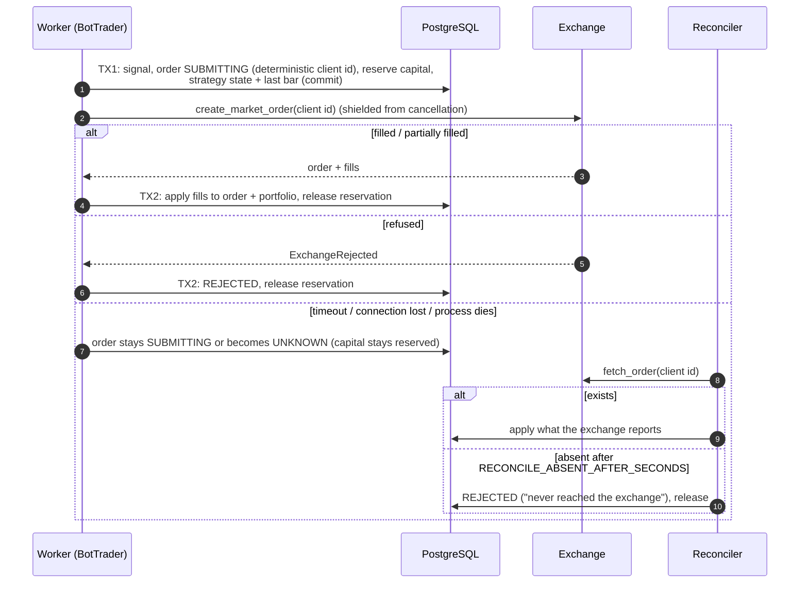

# 12 — Testnet: credentials, order lifecycle, reconciliation, native stops

Phase 4 lets a bot place **real orders on the exchange sandbox** (fake money). Everything the
paper venue simplifies — instant fills, no network, no account — is replaced by the machinery
below. Live trading (real money) is **not** enabled: connections can only be `testnet`.

## Safeguards before anything is sent

| Layer | Rule |
|---|---|
| API | Every business endpoint needs `API_TOKEN` (bearer, constant-time compare). Health checks stay open. `APP_ENV=prod` refuses to start without a token |
| Secrets endpoints | `/exchange-connections` additionally refuses to work while no token is configured, and while `CREDENTIAL_MASTER_KEYS` is missing (503) |
| Storage | Credentials are sealed with Fernet (AES + HMAC) using the master key(s); only ciphertext and the key's last 4 chars are stored. Several keys can be configured for rotation (first encrypts, all decrypt) |
| Exposure | Responses, logs, audit payloads and `repr()` never contain the key or secret (`SecretStr`, masked `Credentials`) |
| Environment | A connection is `testnet` only (`live` is refused). The adapter is built for one environment and the sandbox flag points the client at `testnet.binance.vision` |
| Opt-in | A testnet bot refuses to start unless the worker has `TESTNET_TRADING_ENABLED=true` |
| Validation | Starting a bot resolves and decrypts its connection; a disabled/invalid/missing one puts the bot in `error` instead of trading |
| Decrypting | Only `ConnectionResolver` (worker side) opens credentials |

## The order lifecycle: two transactions, never a network call inside one



* **No duplicates, ever.** The client order id is `hash(bot, candle, side)`, unique in the
  database and (for Binance) sent as `newClientOrderId`, which the exchange also refuses to
  accept twice. An ambiguous failure is *never* retried: it becomes `UNKNOWN` and is resolved by
  lookup. A "duplicate order" answer is treated as success (the first attempt is the order).
* **Capital reservation.** Phase 1 reserves the cash (BUY) or quantity (SELL) the order needs
  (`bot_portfolios.reserved_*`, `orders.reserved_*`); risk sizing uses the *available* balance, so
  two orders cannot spend the same money. The reservation is released when the order is final.
* **Blocked while unresolved.** A bot with an order whose outcome is unknown records new signals
  as rejected ("still unresolved") instead of stacking another order on top.
* **Failures are classified conservatively.** Anything that may have reached the exchange
  (network error, timeout, 5xx, unknown error) is `UnknownOutcome`. Only provable refusals are
  permanent (`ExchangeRejected`), and a 429 (`TransientExchangeError`) is provably not placed.
  Bad credentials (`AuthenticationFailed`) stop the bot at once and mark the connection `invalid`.
* **Real fees.** Binance charges buyers in the asset they receive. A fill carries `fee`
  (quote) and `fee_base` (base units); the portfolio receives `quantity - fee_base`, keeps the
  fee's value in the cost basis, and reports `fees_paid` in quote. A fee in any other asset (BNB)
  is refused loudly (`UnsupportedFeeAsset`) rather than guessed.
* **Dust.** After a sale, a leftover smaller than the market's minimum quantity (a base-fee
  crumb that can never be sold) is written off against realised PnL, so it cannot keep the bot
  "in position" forever. The crumb stays on the exchange, which the account check allows.

## Native stop-loss

For exchanges whose profile says `native_stop_orders` (Binance), once an entry fills the worker
rests a `STOP_LOSS` (market on trigger) order on the exchange for the position (client id derived
from the entry's, so it is idempotent as well). From then on:

* the **exchange** is the authority for the stop; the bot only watches the take-profit itself;
* a strategy/target exit **cancels the resting stop first** (it locks the coins) and, if the stop
  turns out to have fired already, skips the market sell;
* every housekeeping pass (`NATIVE_STOP_POLL_SECONDS`) and every bot start looks the stop up, so a
  stop that fired **while the worker was down** is applied to the portfolio on restart;
* if the stop cannot be placed, the bot falls back to monitoring it candle by candle (audited as
  `stop.placement_failed`);
* the kill switch pauses bots but deliberately **leaves the stops on the exchange**: they protect
  the open positions.

## Reconciliation

Runs inside the worker's supervisor pass (`RECONCILE_INTERVAL_SECONDS`, default 60) and at bot start.

1. **Resolve pending orders** (every pass): each `SUBMITTING`/`UNKNOWN` order is looked up by
   client id and settled (see the diagram). Nothing is re-sent.
2. **Sync native stops** (every `NATIVE_STOP_POLL_SECONDS`).
3. **Account check** (every interval, per connection): all bots on a connection are virtual
   sub-accounts of one exchange account, so the account must hold **at least** what the bots
   believe they own (quote: sum of `cash`; base: sum of `quantity`). Holding more is fine
   (unallocated funds). Holding less, or an open order carrying our `lc-` prefix that we have no
   record of, is a **mismatch**: every bot on the connection is paused with
   `last_error = "reconciliation mismatch"`, the run is stored in `reconciliation_runs` (with the
   problems) and audited. Orders without our prefix (placed by hand) are ignored. The check is
   skipped while orders are unresolved, because books and exchange legitimately differ then.

## Operating it

```bash
make master-key                      # a Fernet key for CREDENTIAL_MASTER_KEYS
# .env (never commit): API_TOKEN=..., CREDENTIAL_MASTER_KEYS=..., TESTNET_TRADING_ENABLED=true
curl -H "Authorization: Bearer $API_TOKEN" -X POST $B/exchange-connections \
  -d '{"label":"my-testnet","api_key":"...","api_secret":"..."}' -H 'content-type: application/json'
curl -H "Authorization: Bearer $API_TOKEN" -X POST $B/bots -H 'content-type: application/json' -d '{
  "name":"ema-testnet","mode":"testnet","connection_id":"<id>","symbol":"BTC/USDT",
  "strategy_type":"trend_quality_breakout","strategy_params":{"entry_period":40,"exit_period":20}}'
```

Keys come from https://testnet.binance.vision (GitHub login). Use testnet keys only; withdrawal
rights are irrelevant there but must never be enabled on real keys later.

## What is verified, and how

| Claim | Verified by |
|---|---|
| Lifecycle, reservations, UNKNOWN/crash recovery, duplicate prevention, stops, reconciliation | `tests/integration/test_phase4_testnet.py` against a **simulated** exchange account with failure injection |
| Response parsing, error classification, params sent | `tests/unit/test_binance_orders.py` with Binance-shaped payloads (documented format, not a recording) |
| Sandbox URL, market-rule parsing and the `-2015` authentication failure on **every** call path | run against the **real** testnet with deliberately invalid keys |
| Real orders: fills, fee assets, `newClientOrderId` idempotency, stop orders | **Not verified here (no keys).** `make test-testnet` (`tests/smoke`) runs it for you with your testnet keys |

## Known limitations

* Market orders and market-on-trigger stops only; no limit orders, OCO or native take-profit.
* Fills are found by polling (no user-data WebSocket); latency is the poll interval.
* Fee assets other than the base/quote asset (BNB discount) are rejected, not valued.
* Rate limiting is CCXT's per-process limiter; a shared, weight-aware limiter is needed before
  several processes use one key.
* The backtester still sizes all-in; it does not mirror the bot's risk sizing or real fees.
* No live environment: the connection API refuses it until its own safeguards (doc 05) exist.
