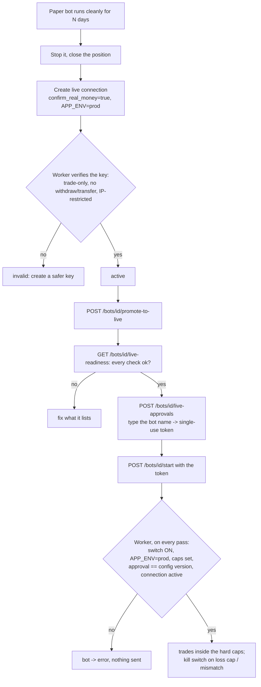

# 13 — Live trading (real money): safeguards and how they are enforced

> **No strategy is assumed profitable and live trading can lose money.** This document describes
> the machinery that makes it hard to lose money *by accident*. It does not make trading safe.
> Live trading is **off by default** and nothing in the test suite or in this repository ever
> sends a real order (the live path is exercised against a simulated account only).

The ten safeguards of [doc 05](05-execution-environments.md), and where each one lives:

| # | Safeguard | Enforced by |
|---|---|---|
| 1 | Global switch `LIVE_TRADING_ENABLED` (default false), on the **worker** | `BotSupervisor._mode_problem`, evaluated on **every pass** (not only at start): a worker restarted with the switch off puts a running live bot in `error` instead of trading |
| 2 | Separate live connection, production keys | `ExchangeConnection.environment = live`; the adapter serves exactly one environment and asserts the client's host matches it (`CcxtExchange`); `APP_ENV=prod` required to even create a live connection |
| 3 | Bot-level opt-in, never via generic edit | A bot cannot be **created** or **PATCHed** into live; only `POST /bots/{id}/promote-to-live` (stopped bots, ACTIVE live connection, flat position) |
| 4 | Explicit confirmation | Two steps: `POST /bots/{id}/live-approvals` (readiness checklist + the bot's exact name typed) returns a **single-use token, valid minutes, bound to one configuration version**; `POST /bots/{id}/start` must present it **every time** (also after a pause/kill switch) |
| 5 | Prerequisite history | Readiness: `LIVE_MIN_PAPER_DAYS` of paper snapshots **and** no risk breach/error events before promotion |
| 6 | Hard caps independent of bot config | `LIVE_MAX_ORDER_NOTIONAL`, `LIVE_MAX_TOTAL_EXPOSURE`, `LIVE_MAX_DAILY_LOSS` in the worker environment; enforced in the trader (tightens the bot's own limits; exposure counted over live bots only), again in the `OrderExecutor` right before sending, and the daily-loss cap trips the **global kill switch** |
| 7 | Trade-only keys, no withdrawals | A live connection starts `pending`; the **worker** reads the key's permissions (Binance `apiRestrictions`) and activates it only if it can trade, **cannot withdraw or transfer**, and (default) is IP-restricted. Otherwise `invalid` |
| 8 | Kill switch | Existing global switch; now also tripped automatically by the live daily-loss cap and by a reconciliation mismatch on a live account. Native stops stay on the exchange to protect open positions |
| 9 | Startup guard | The worker logs a one-line banner of what it may do; live bots with a switch off go to `error` (never silently downgraded to paper) |
| 10 | Audit | `live.promoted`, `live.approval_requested`, `live.activated`, orders, reconciliation, kill switch, connection verification: all append-only |

Plus the defence in depth that does not depend on any single check:

* **The API is not trusted by the worker.** Editing the database to set `desired_state=running`
  does not start a live bot: the worker requires `live_approved_config_version == config_version`,
  the switch, `APP_ENV=prod`, complete caps and an ACTIVE live connection on every pass.
* **Any configuration change voids the approval** (the version moves); stopping ends it.
* **Roles:** state-changing endpoints need the `admin` role ([doc 14](14-authentication.md)).

## The path to the first live order



## Configuration (worker **and** API share the same values)

```bash
APP_ENV=prod                       # live never runs in local/test
JWT_SECRET=...  API_TOKEN=...      # authentication is mandatory outside local
CREDENTIAL_MASTER_KEYS=...         # encrypts the exchange keys
LIVE_TRADING_ENABLED=true          # the master switch (default false)
LIVE_MAX_ORDER_NOTIONAL=50         # quote currency, per order
LIVE_MAX_TOTAL_EXPOSURE=200        # quote currency, all live positions together
LIVE_MAX_DAILY_LOSS=20             # quote currency, per bot per UTC day
LIVE_MIN_PAPER_DAYS=7              # default 7
LIVE_REQUIRE_IP_RESTRICTION=true   # default true
```

Start tiny. The caps exist so that a wrong bot, wrong strategy or wrong day costs a number you
chose in advance.

## What was verified, and what was not

| Claim | How |
|---|---|
| Each guard in the table above refuses when it is the only thing missing; nothing is sent | `tests/integration/test_phase5_live.py` (15 tests, simulated account) and `tests/unit/test_live_safeguards.py` |
| The live order path (fills, fee assets, `newClientOrderId`, stop orders) works against Binance | **Not verified.** It is the same code as the testnet path, itself only verified against the simulator plus the real testnet's authentication failure |
| Reading API-key permissions (`sapi/v1/account/apiRestrictions`) | **Not verified against Binance**: the method exists in CCXT but needs a real key; the response fields follow Binance's documentation |
| Behaviour with real fills, latency, partial fills, BNB fee discount | **Not verified** |

Before any real money: run `make test-testnet` with testnet keys, then paper-trade, then promote
with caps small enough that you would shrug at losing them.

## Known limitations

* The hard daily-loss cap is per bot (absolute, quote currency), not a portfolio-wide sum.
* The paper-days gate is computed from snapshots of the bot's own paper sessions.
* The live reconciliation check is the same "exchange holds at least what the books say" test as
  the testnet; it cannot detect funds that moved *into* the account.
* Market orders and market-on-trigger stops only; no limit/OCO orders, no WebSocket fills.
* One API key can serve several bots (virtual sub-accounts); a manual trade on that account by a
  human is outside the books.
