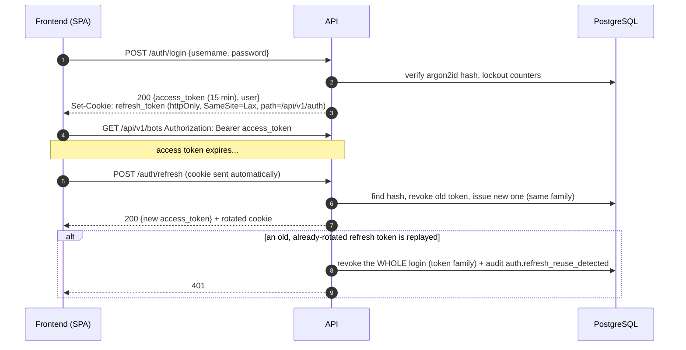

# 14 — Authentication and authorization (for the frontend)

Two kinds of caller, one header (`Authorization: Bearer <token>`):

| Caller | Credential | Role | Typical use |
|---|---|---|---|
| **User** (the frontend) | short-lived **JWT access token** from `POST /auth/login`, renewed with a **refresh cookie** | `admin` or `viewer` | dashboards, bot control |
| **Service** | static `API_TOKEN` | `admin` | scripts, `curl`, monitors |

Health checks (`/health`, `/health/live`) stay open for probes. Authentication may be disabled
only on a developer machine (`APP_ENV=local` with neither `JWT_SECRET` nor `API_TOKEN`); any other
environment refuses to start without one, and endpoints that accept exchange keys refuse to work
while authentication is off.

## Session design



* **Access token:** JWT HS256 (`JWT_SECRET`, ≥ 32 chars), 15 min, claims `sub, usr, role, typ=access,
  iss, iat, exp`. Verified without the database. The algorithm is pinned (no `alg: none`), expiry is
  checked against the injected clock.
* **Refresh token:** 48 random bytes, **only its SHA-256 is stored**. Delivered solely as an
  `httpOnly` cookie scoped to `/api/v1/auth`, so page scripts (XSS) can never read it. Each refresh
  **rotates** it; replaying a rotated token revokes the entire login. A 10 s grace tolerates a
  double-fired refresh.
* **CSRF:** `SameSite=Lax` + `POST` only + an `Origin` check against `CORS_ORIGINS` on login,
  refresh and logout.
* **Passwords:** argon2id; policy = ≥ 12 characters, not the username, not trivially guessable.
  Unknown users and wrong passwords cost the same time and return the same message.
* **Brute force:** 5 consecutive failures lock the account for 15 minutes (`LOGIN_MAX_FAILURES`,
  `LOGIN_LOCKOUT_MINUTES`); a locked account answers exactly like a wrong password, so lockouts do
  not reveal which usernames exist.
* **Changing a password** signs the user out of every device. **Disabling a user** revokes all
  their sessions (their current access token still works until it expires, ≤ 15 min).

## Roles

| Role | Can |
|---|---|
| `viewer` | every `GET` (bots, orders, metrics, backtests, audit, status, readiness) |
| `admin` | everything: any `POST/PUT/PATCH/DELETE` (start/stop bots, kill switch, live approvals, credentials, users) |

The rule is enforced centrally on every protected router: a non-`GET` request from a `viewer` is
`403`. User management (`/auth/users`) is admin-only even for reads.

## Endpoints (`/api/v1/auth`)

| Endpoint | Auth | Purpose |
|---|---|---|
| `POST /login` | open | username + password → access token (+ refresh cookie) |
| `POST /refresh` | cookie | new access token, rotated cookie |
| `POST /logout` | cookie | revoke this login, clear the cookie (idempotent) |
| `GET /me` | any user | the signed-in user, role and `can_write` (may this user change anything?) |
| `POST /change-password` | any user | set a new password (the current one is not asked); signs out everywhere |
| `GET/POST /users`, `POST /users/{id}/disable`, `.../enable` | admin | manage users (an admin cannot disable themselves) |

## First admin

Nobody can log in on a fresh install, so the first user is created on the server:

```bash
make jwt-secret                         # put the output in JWT_SECRET
make create-admin                       # local; prompts for the password
docker compose exec api python -m manage create-user daniel --role admin     # in Docker
```

## Other endpoints the frontend uses

| Endpoint | Purpose |
|---|---|
| `GET /system/capabilities` | Is live possible in this deployment, and if not, why (`live_blockers`); registered exchanges and strategies; paper-days and approval-window settings. No secrets. It describes the **API process's** configuration, the worker enforces its own on every pass |
| `GET /bots/summary` | Equity, PnL, fees, running bots and open positions added up per execution mode and quote currency (never mixed) |
| `limit` + `offset`, header `X-Total-Count` | On `GET /audit-events` (also `event_type`), `/bots/{id}/orders`, `/bots/{id}/signals`, `/backtests`: newest first, the header carries the size of the whole list (exposed through CORS) |

## What the frontend does

1. `POST /auth/login` with `credentials: "include"`; keep `access_token` **in memory** (not
   `localStorage`).
2. Send `Authorization: Bearer <access_token>` on every request.
3. On a `401`, call `POST /auth/refresh` once (with `credentials: "include"`), retry the request;
   if refresh fails, show the login screen.
4. Call `GET /auth/me` after login/refresh to learn the role and hide admin-only controls.
5. `POST /auth/logout` on sign-out.
6. Serve the frontend from an origin listed in `CORS_ORIGINS` (default `http://localhost:5173`); CORS
   allows credentials for exactly those origins.

## Limitations

* Login throttling is per account, not per IP; put a reverse proxy rate limit in front for public
  deployments. TLS is terminated outside (cookies are `Secure` whenever `APP_ENV` is not `local`).
* No password reset by email and no MFA yet: a forgotten password is reset by an operator with
  `manage`-style access to the database/host.
* Access tokens are stateless, so revoking them early is not possible (hence the 15-minute life).
