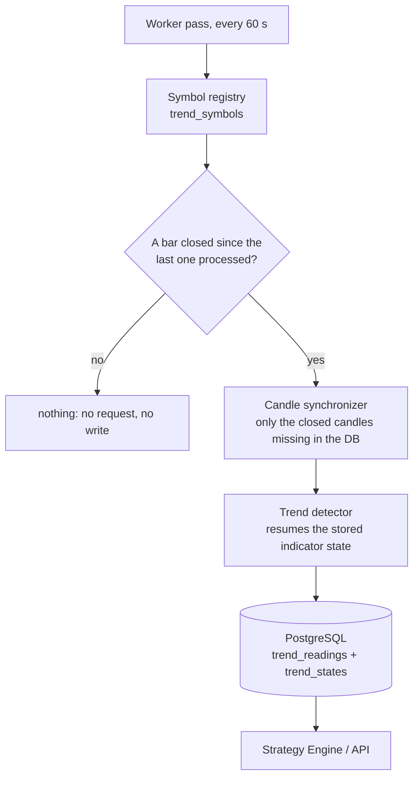

# 19 — Trend detector

The detector labels every followed pair **BULLISH, BEARISH or SIDEWAYS** on four timeframes
(1w, 1d, 4h, 1h) and stores the result, so strategies, risk and dashboards read a stored trend
instead of each recomputing it.

## The rule

Two EMAs of the bar closes per timeframe (`market_data/domain/trend.py`, pure, no I/O):

| Timeframe | EMAs | Role |
|---|---|---|
| 1w | 20 / 50 | macro context |
| 1d | 20 / 50 | main direction |
| 4h | 20 / 50 | confirm the trend, find corrections |
| 1h | 9 / 21 | short-term entry timing |

* BULLISH: `close > fast EMA > slow EMA`. BEARISH: `close < fast EMA < slow EMA`. Anything else is
  SIDEWAYS. A frame with fewer than `slow` completed bars is *unknown* (`trend = null`), not
  sideways.
* Only completed bars are read; 4h, 1d and 1w bars are built in UTC (weeks start on Monday 00:00
  UTC), so a reading never contains the future.
* EMA lengths, `min_distance_pct`, `adx_min`, ADX period, slope window and swing window are
  `TrendSettings` parameters, per timeframe, with the defaults above.

### Confirmation

A directional trend is **confirmed** when four independent checks pass (`checks` in every row):

| Check | Passes when |
|---|---|
| `distance` | the EMAs are at least `min_distance_pct` % apart |
| `slope` | the slow EMA moved in the trend's direction over the last 5 bars |
| `adx` | Wilder's ADX(14) is at least 25 |
| `structure` | the last two swing highs and lows are both higher (bullish) / lower (bearish) |

Each check is `true`, `false` or `null` (not enough data yet).

## What runs when

A pass is cheap: it compares the stored last bar of each (symbol, timeframe) with the newest
closed bar. Work happens only when a bar closed:

| Timeframe | Updated | Candles fetched from the exchange |
|---|---|---|
| 1w | each Monday 00:00 UTC | none: built from the stored daily candles |
| 1d | each day 00:00 UTC | 1d |
| 4h | every 4 hours (6/day) | 4h |
| 1h | every hour (24/day) | 1h |

The synchronizer asks the exchange only for candles that closed and are not stored yet (one
request per closed bar; a one-off backfill of `TREND_WARMUP_BARS` bars when a pair or frame is
new). A 429 pauses the exchange for its `Retry-After`; an unknown symbol is parked for an hour;
missing candles in the stored range make the frame wait instead of computing on a hole.

## Storage (migration 0040)

* `trend_symbols`: the registry (`exchange`, `symbol`, `active`).
* `trend_readings`: one row per closed bar and frame, with the trend, the previous trend, the
  indicators (`close`, EMAs, distance %, slope %, ADX, ATR, structure), the checks and the bar's
  open time. History is kept.
* `trend_states`: the last processed bar and the indicator state to resume from, plus a
  `settings_key`. Changing the EMA lengths restarts that frame from its warm-up.

## API (`/api/v1/trends`)

| Method | Path | Purpose |
|---|---|---|
| GET | `/symbols` | the registry |
| POST | `/symbols` | follow a pair: `{"exchange": "binance-usdm", "symbol": "BTCUSDT"}` (the exchange must list it) |
| POST | `/symbols/{id}/deactivate`, `/activate` | stop / resume following (readings are kept) |
| GET | `/` | newest reading of each timeframe, per followed pair (`?symbol=`, `?exchange=`) |
| GET | `/history` | readings of one timeframe, newest first (`frame`, `limit`, `before`) |

Settings: `SYMBOL_REGISTRY_ENFORCED`, `TREND_DETECTOR_ENABLED`, `TREND_DETECTOR_INTERVAL_SECONDS` (60),
`TREND_DETECTOR_GRACE_SECONDS` (5), `TREND_WARMUP_BARS` (150).

## The registry is the system's allow-list

With `SYMBOL_REGISTRY_ENFORCED=true` (the default) only registered, active pairs can be used:

* creating, re-pairing or starting a **bot**, creating a **backtest** or a **sweep**, and requesting a **candle import** are refused with `422` and a hint (`core/symbols.py`, `trends/application/guard.py`);
* the **candle updater** only extends the series of registered pairs;
* a pair cannot be **deactivated** while a bot that is not stopped uses it (`409`).

Bots that were already running keep running (they are not stopped retroactively), but they cannot be started again once their pair is out of the registry. Set the variable to `false` to work with any pair (the automated tests do).

## Validating the detector

`python -m manage trend-study BTC/USDT:USDT --since 2020-01-01` runs a forward-return study of
the labels on real candles (`backtesting/domain/trend_validation.py`): the return after each
BULLISH / BEARISH / SIDEWAYS reading, the edge between them with a block-bootstrap interval, the
same for confirmed trends and for each check, the first and second half of the sample, and a
control on random walks of the same volatility. Read it before trusting a timeframe: on BTC, ETH
and SOL the 1d and 4h labels carried information, the 1h label did not.
