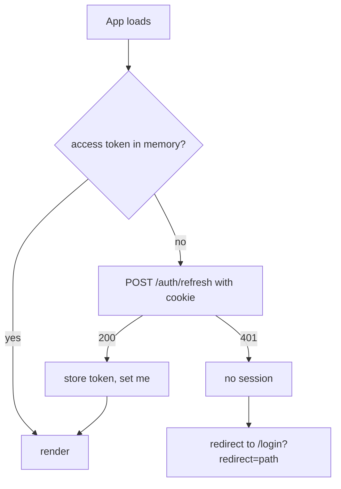

# 05 — Authentication and permissions

The contract is the backend's [doc 14](../../api/docs/architecture/14-authentication.md). This document is what the **frontend** does with it.

## Session model

| Piece | Where it lives | Lifetime |
|---|---|---|
| Access token (JWT) | **JavaScript memory** (module variable in `lib/shared/api/session.ts`) | 15 min (`expires_in` = 900 s) |
| Refresh token | httpOnly cookie on the **API** origin, `Path=/api/v1/auth`, `SameSite=Lax` (`Secure` outside local) | 7 days, rotated on every refresh |
| Current user (`id, username, role`) | TanStack Query cache, key `QueryKey.Auth.me()` | refetched on login/refresh |

Never `localStorage`/`sessionStorage`/IndexedDB for the access token, and never the refresh token anywhere script can reach (it cannot: that is the point). Consequences to accept: a **page reload loses the access token**, so every cold start begins with a silent `POST /auth/refresh` (see bootstrap). The `API_TOKEN` of the backend is not a user credential and the app has no field, env var or code path for it (F7).

## Endpoints used

| Call | Auth | Used for |
|---|---|---|
| `POST /auth/login` `{username, password}` | open | login → `{access_token, expires_in, user}` + cookie |
| `POST /auth/refresh` | cookie | silent renewal; also the bootstrap on reload; rotates the cookie |
| `POST /auth/logout` | cookie | end this login (idempotent, 204) |
| `GET /auth/me` | bearer | role and username for the UI |
| `POST /auth/change-password` | bearer | profile; **signs out every device** |
| `GET/POST /auth/users`, `POST /auth/users/{id}/disable|enable` | bearer, admin | users screen |

The three cookie endpoints (`login`, `refresh`, `logout`) are `fetch(..., { credentials: "include" })`. The browser adds the `Origin` header itself; the app's origin must be in the backend's `CORS_ORIGINS` or these answer 403.

## Bootstrap (cold start / reload)

* `_app.tsx` `beforeLoad` awaits `ensureSession()` once per navigation (it returns immediately when the token is valid with more than ~30 s left). It runs in the browser (client-only mode, F2).
* Concurrent callers share **one** refresh promise (single-flight). The backend tolerates a double-fired refresh for 10 s, but a second *rotation* of the same token after that revokes the whole login, so single-flight is a correctness requirement, not a nicety.
* The login screen skips the refresh attempt on its own mount when the user just logged out (flag in memory), to avoid a pointless 401.

## Handling 401

On any API 401 other than login/refresh: `ensureSession({ force: true })` once → retry the original request once → otherwise `clearSession()`, clear the Query cache, redirect to `/login?redirect=<current path>`. After a failed refresh the user is told once ("Sua sessão expirou"), not on every parallel request that failed.

**Refresh reuse = forced logout.** If the backend detects a replayed refresh token it revokes the family; every device is logged out. The only way the app causes this is by rotating twice concurrently, hence single-flight, and by keeping the refresh in one tab at a time: sessions are shared across tabs because the cookie is, but the access token is per tab. Two tabs refreshing within 10 s are tolerated; more than that, in the worst case, ends in a clean redirect to login — never in a loop (the redirect path does not retry).

Optional hardening (decide at build time, record the result here): use `BroadcastChannel` so the tab that refreshed publishes the new token to the others.

## Logout and password change

* Sign out: `POST /auth/logout`, then `clearSession()`, `queryClient.clear()` (so one operator's data never lingers in memory), navigate to `/login`. Do it even if the request fails (network): the local state must go.
* `POST /auth/change-password` ends every session including this one: after success show the message and go to `/login` — do not try to continue with the old token.

## Login screen

`LoginPage` from lost-ui with `identifier="text"` (username), no register/forgot links (there is no self-service sign-up or reset; users are created by an admin or by the `manage` CLI on the server), `onSubmit` calls `login()` and:

* success → store the token, `setQueryData(Auth.me)`, navigate to the validated `redirect` param (same-origin paths starting with `/` only; anything else → `/`).
* failure → return one pt-BR text: "Usuário ou senha inválidos, ou conta temporariamente bloqueada." The backend deliberately does not say which (lockout after 5 failures / 15 min). The UI never shows a countdown or "account locked".
* network/5xx → a different message ("Não foi possível falar com o servidor") so an outage is not read as a wrong password.

## Roles and permissions

Two roles, enforced **by the backend**; the frontend only reflects them.

| Role | Can |
|---|---|
| `viewer` | every `GET` |
| `admin` | everything, including start/stop bots, kill switch, live promotion/approval, connections, users |

The app's permission model is a single function, `can(role, capability)`, with a small `Capability` registry (`as const`): `Bots.Control`, `Bots.Edit`, `Bots.PromoteLive`, `Backtests.Run`, `MarketData.Import`, `Exchanges.Manage`, `System.KillSwitch`, `Users.Manage`. Today every capability maps to `admin`; the indirection exists so a third role changes one table.

Applied in four places, and only the first three are the app's job:

1. **Navigation**: items get `hidden: !can(...)` (lost-ui `NavItem`), e.g. *Usuários* only for admin.
2. **Route guard**: `beforeLoad` redirects a viewer from write-only routes (`bots/new`, `exchanges/new`, `settings/users`) to a `ForbiddenPage`.
3. **Controls**: a viewer sees buttons hidden, or disabled with the reason when it is not obvious ("Somente administradores") — never a button that always fails.
4. **Backend**: the real enforcement (403 for any non-GET from a viewer). The UI must still handle a 403 gracefully because a role can change while a tab stays open; on a 403 the app refetches `/auth/me`.

A **disabled** user keeps a working access token for up to 15 minutes. The app does not try to hide that; the next refresh fails and logs them out.

## Exchange keys

`POST /exchange-connections` takes `api_key` and `api_secret`. They are the most sensitive values the frontend ever touches:

* Inputs are `FormInputPassword` with `autocomplete="off"`, no `name` that password managers recognise as a login.
* They live only in the form's state; after a successful or failed submit the secret field is cleared. They are never put in the Query cache (the mutation's `variables` are not persisted: do not use `useMutation`'s `variables` for display), never in the URL, never logged, never sent to any other endpoint.
* After creation the response contains only `api_key_hint` and a `status`; that hint is all the UI can show, ever. There is no "reveal" and no edit-the-secret flow (create a new connection, disable the old one).
* A `live` connection requires an explicit "I understand this uses real money" checkbox (`confirm_real_money: true`), appears only when the backend reports it can create it (see 06), and starts as `pending` until the worker verifies the key is trade-only, no withdraw/transfer, IP-restricted. The UI explains each state of `ConnectionStatus` (`pending`, `active`, `invalid`, `disabled`) and what the operator can do (an `invalid` key is replaced by a safer one).

## Browser hardening

* Set a strict **Content-Security-Policy** on the static host (`default-src 'self'`; `connect-src` the API origin only; no inline scripts beyond what the build needs) and `Referrer-Policy: no-referrer`, `X-Content-Type-Options: nosniff`, `frame-ancestors 'none'`. The access token in memory is only as safe as the page's script integrity.
* Render API-provided strings (`last_error`, `reject_reason`, audit `payload`, bot names) as text, never as HTML; the editor and any `dangerouslySetInnerHTML` are not used in this app.
* Dependencies are few and pinned by the lockfile; `npm audit` runs in CI (see [08](08-quality.md)).
